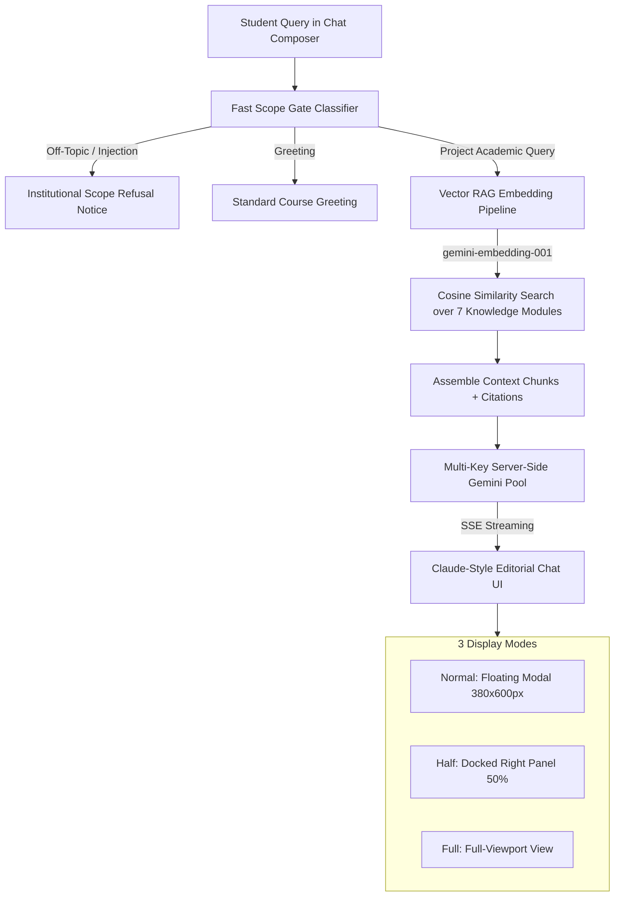
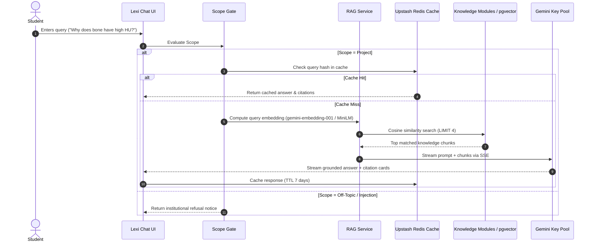

# AI Agents & Tutor Specification

**Project:** Medical Text and Image Processing Learning Platform (AIDS 12605.1)  
**Institution:** Faculty of Engineering and Technology, Adani Institute of Higher Education and Research (Deemed to be University)  
**Primary Engine:** Google Gemini 1.5 Flash (with Multi-Key Pool & Flash-Lite fallback)  
**Secondary Fallback:** Groq Cloud Llama 3.3 70B (Free Tier)  
**Status:** Approved for Implementation  

---

## 1. System Overview & Core Principles

The AI system is strictly an academic accelerator and educational guide. It serves three distinct functions:
1. **Lexi Academic AI Guide v2.0:** Real-time conversational academic guide embedded on topic pages and available in full-page / docked modes, answering student queries grounded strictly in the syllabus.
2. **Automated Quiz & Assessment Generator:** Authoring assistant for faculty to generate Bloom's-aligned questions from approved topic text.
3. **Short-Answer Rubric Evaluator:** Formative assessment evaluator providing nuanced grading and feedback against faculty rubrics, subject to faculty override.

### 1.1 Non-Negotiable Safety & Academic Guardrails
1. **Absolute Refusal of Clinical / Diagnostic Advice:** If a student asks for personal diagnoses or clinical evaluations, the agent must refuse and output the standard clinical disclaimer:
   > *"I am an educational AI tutor for B.Tech Medical Image Processing (AIDS 12605.1) at Adani University. I cannot interpret personal medical images or provide medical/diagnostic advice. Please consult a licensed medical professional."*
2. **Zero Hallucination / Strict Syllabus Grounding:** The tutor answers *only* using context retrieved from approved course documentation and topic embeddings.
3. **Mandatory Topic Citations:** Every substantive factual assertion must cite the exact topic title, section number, and reference code.
4. **Diagram Node Highlighting:** When discussing a component (e.g., "ADC Converter", "Fourier Slice"), the agent specifies the diagram node ID to highlight on the student's screen.
5. **Fast Scope Gate & Prompt Injection Trapping:** Out-of-scope queries (general politics, web dev, entertainment) or adversarial prompt injection attempts are trapped and refused with an exact institutional notice.

---

## 2. Lexi Academic AI Guide v2.0 Architecture

Lexi v2.0 features a state-of-the-art Claude-style architecture with multi-key rate-limiting resilience:



### 2.1 Claude-Style Chat UI
- **User Messages:** Right-aligned speech bubble with distinct styling.
- **Lexi Responses:** Open editorial layout without repetitive headers, bulky avatars, or harsh dividing borders.
- **Composer:** Floating rounded card composer with inner toolbar, active model badge, circular upward send button, and disclaimer text.
- **Real-time Indicators:** Subtle thinking indicator pill and collapsible citation source cards (`{ file, section }`).

### 2.2 Three Seamless Display Modes
- **Normal (Default):** Bottom-right compact floating window ($380\text{px} \times 600\text{px}$, max 80vh) with slide-over history drawer.
- **Half:** Right docked panel (50% desktop, 40% tablet); the host topic page dynamically shrinks beside it (`flex-1`) with zero overlays.
- **Full:** Full-viewport experience with collapsible sidebar and centered conversation column.
- Single mounted component with 200ms smooth transitions preserving active SSE streaming, scroll position, and input drafts.
- **Global Shortcuts:**
  - `Ctrl/Cmd + J`: Toggle Lexi open/closed.
  - `Ctrl/Cmd + Shift + 1 / 2 / 3`: Switch between Normal, Half, and Full modes.
  - `Ctrl/Cmd + K`: Focus composer input.
  - `Esc`: Close or exit full mode.

---

## 3. RAG Retrieval Architecture



---

## 4. System Prompts & Contracts

### 4.1 Course AI Tutor System Prompt
```markdown
You are Lexi, the Official Academic AI Guide for "Medical Text and Image Processing (AIDS 12605.1, B.Tech Sem VI)" at the Faculty of Engineering and Technology (FET), Adani Institute of Higher Education and Research (Deemed to be University).

YOUR MISSION:
Help students master medical imaging physics, image processing algorithms, spatial transforms, and clinical NLP strictly aligned with the course syllabus.

CONTEXT INFORMATION:
The student is viewing topic: "{topic_title}" (Module {module_number}).
Below is the verified curriculum content retrieved from course documentation:
---------------------
{retrieved_context}
---------------------

STRICT OPERATIONAL RULES:
1. Base your answer EXCLUSIVELY on the provided syllabus context and foundational mathematics. Do not speculate or invent facts.
2. If the user asks for personal medical diagnoses, symptom interpretation, or real clinical advice, reply with the MANDATORY CLINICAL REFUSAL.
3. If the question is outside the scope of Medical Text and Image Processing (AIDS 12605.1), politely state that you can only assist with this course's syllabus.
4. Always provide an explicit citation at the bottom of your response in the format:
   "[Citation: {module_title} -> {topic_title}, Section {section_number}]"
5. If the topic includes a diagram and your explanation discusses a specific node, output the node tag in JSON:
   `{"highlight_node": "<Node_ID>"}`.
6. Use KaTeX notation for all equations (e.g., $f(x, y)$, $H(u, v)$).
```

### 4.2 Quiz Question Generator (Faculty Authoring Tool)
```markdown
You are an expert medical engineering exam author for course AIDS 12605.1 at Adani University.
Generate {num_questions} Multiple Choice Questions based STRICTLY on the following approved topic content:
---------------------
{topic_content}
---------------------

REQUIREMENTS:
1. Align with Course Outcome: {co_tag}.
2. Bloom's Taxonomy Level: {blooms_level} (Understanding, Application, Analysis).
3. Return output strictly in JSON array format:
[
  {
    "question_text": "string",
    "co_tag": "string",
    "difficulty": "easy|medium|hard",
    "options": [
      {"id": "A", "text": "string"},
      {"id": "B", "text": "string"},
      {"id": "C", "text": "string"},
      {"id": "D", "text": "string"}
    ],
    "correct_option_id": "A|B|C|D",
    "explanation": "Detailed explanation of why the correct option is right."
  }
]
```

---

## 5. Multi-Key Pool & Quota Resilience

To strictly adhere to free-tier constraints:
- **Server-Side API Key Pool:** Keys loaded from `GEMINI_API_KEYS` in backend and frontend `.env`.
- **Automatic Round-Robin & Backoff:** Rotates to the next key upon encountering `429 Too Many Requests` or `503 Service Unavailable`, with exponential backoff.
- **Upstash Redis Query Cache:** Caches responses by SHA-256 hash of normalized prompt + topic_id to reduce LLM quota consumption by $>40\%$.
- **Automated Evaluation Suite:** 40 test cases across 5 categories in `eval/project-eval.ts` achieving **100% (40/40)** accuracy.
