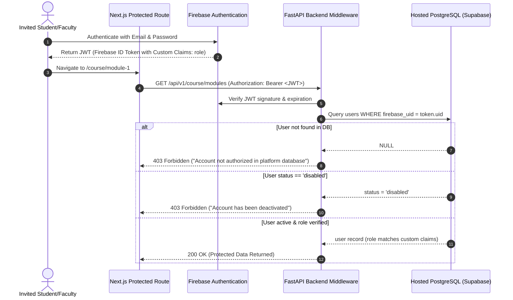

# Authentication, Access Control & Security Specification

**Project:** Medical Text and Image Processing Learning Platform (AIDS 12605.1)  
**Provider:** Firebase Authentication (Spark Free Plan) + Hosted PostgreSQL RBAC  
**Status:** Approved for Implementation  

---

## 1. Absolute Rule: 100% Invite-Only Platform

This learning platform operates under an uncompromising access control policy:
- **No Self-Registration:** There is no public registration form, no "Sign Up" button, and no social identity provider (Google, GitHub, etc.) open to the general public.
- **Admin-Only User Provisioning:** Only an authenticated user with the `admin` role can create user accounts.
- **Firebase Project Lockdown:** Public user account creation must be disabled in the Firebase Console settings (`Authentication -> Settings -> User actions -> Enable email/password sign-up = FALSE`).
- **First-Time Password Setup:** The administrator initiates an invite; the backend invokes `firebase_admin.auth.generate_password_reset_link()` and emails the secure activation link.
- **Mandatory First-Login Password Change:** The user must establish a private password on initial authentication before gaining access to curriculum modules.

---

## 2. Dual-Layer Identity Architecture

Identity and authorization are strictly decoupled across two synchronized tiers:



### 2.1 Firebase Custom Claims
Roles are injected into the Firebase Auth token payload as custom claims:
```json
{
  "role": "student" // or "faculty" or "admin"
}
```
Custom claims are assigned *exclusively* from the backend using the Firebase Admin SDK:
```python
firebase_admin.auth.set_custom_user_claims(firebase_uid, {"role": role})
```

### 2.2 PostgreSQL `users` Table Mirroring
Every authorized user has an exact mirrored record in the hosted PostgreSQL `users` table:
- `firebase_uid`: Unique string ID from Firebase.
- `email`: Institutional email address (`@dmiher.edu.in`).
- `role`: PostgreSQL ENUM (`'student'`, `'faculty'`, `'admin'`).
- `status`: PostgreSQL ENUM (`'active'`, `'disabled'`, `'pending_first_login'`).
- `force_password_change`: Boolean flag.

Even if an unauthorized user manages to obtain a valid Firebase account by external means, the backend rejects their request with HTTP `403 Forbidden` because their UID does not exist with `status = 'active'` in the hosted database.

---

## 3. Role-Based Access Control (RBAC) Matrix

| Resource / Route / Action | Unauthenticated | Student | Faculty | Admin |
| :--- | :---: | :---: | :---: | :---: |
| `/login` & Password Setup | Allowed | Allowed | Allowed | Allowed |
| `/course/**` (Topic Pages & Demos) | Blocked (401) | Read-Only | Read-Only | Read-Only |
| `/assessments/**` (Take Quizzes) | Blocked (401) | Take & Retake | Preview | Preview |
| `/assessments/my-attempts` | Blocked (401) | Read Own | Read All | Read All |
| `/playground` (Client-side Tools) | Blocked (401) | Allowed | Allowed | Allowed |
| `/faculty/**` (Authoring & Analytics) | Blocked (401) | Blocked (403) | Full Access | Full Access |
| `/faculty/visuals/approve` | Blocked (401) | Blocked (403) | Full Access | Full Access |
| `/admin/**` (User & Role Management) | Blocked (401) | Blocked (403) | Blocked (403) | Full Access |
| Bulk CSV User Provisioning | Blocked (401) | Blocked (403) | Blocked (403) | Full Access |
| System Audit Logs Inspection | Blocked (401) | Blocked (403) | Blocked (403) | Full Access |

---

## 4. First-Admin One-Time Bootstrap Script

To initialize the invite-only ecosystem without relying on open sign-up, a secure CLI script is executed once during initial deployment:

```bash
python scripts/bootstrap_admin.py --email admin@dmiher.edu.in --name "System Administrator"
```

### Bootstrap Workflow:
1. Reads `INITIAL_ADMIN_EMAIL` and `FIREBASE_SERVICE_ACCOUNT_KEY` from secure environment variables.
2. Checks if an admin already exists in the hosted PostgreSQL database. If yes, terminates immediately to prevent re-bootstrapping.
3. Calls Firebase Admin SDK to create the user account with a secure temporary password.
4. Assigns custom claims `{"role": "admin"}`.
5. Inserts the record into the hosted PostgreSQL `users` table with `role = 'admin'` and `status = 'active'`.
6. Generates a password reset link and prints it to the terminal for initial secure onboarding.
7. Logs the bootstrap event into `audit_logs`.

---

## 5. Security & Audit Logging Discipline

1. **Zero Secret Leaks:**
   - The Firebase Service Account private key (`service-account.json`) is **NEVER** committed to Git or exposed to the client.
   - It is loaded via base64 environment variable `FIREBASE_SERVICE_ACCOUNT_B64` on the backend.
2. **Audit Logging:** Every administrative action (inviting a student, changing a role, deactivating an account, resetting a password) is written synchronously to the `audit_logs` table with:
   - `actor_id` (admin user ID)
   - `action` (`INVITE_USER`, `DISABLE_USER`, `OVERRIDE_GRADE`)
   - `target_id` (affected student/user)
   - `ip_address`
   - `timestamp`
3. **Session Revocation:** If an admin marks a student's status as `disabled`, the backend immediately revokes the user's Firebase refresh tokens via `firebase_admin.auth.revoke_refresh_tokens(uid)`.
