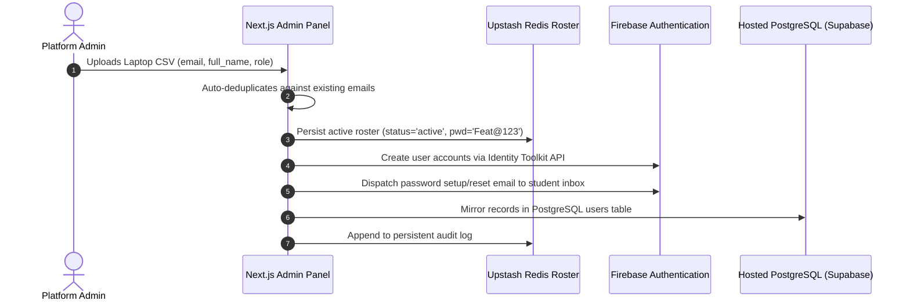

# Authentication, Access Control & Security Specification

**Project:** Medical Text and Image Processing Learning Platform (AIDS 12605.1)  
**Institution:** Faculty of Engineering and Technology, Adani Institute of Higher Education and Research (Deemed to be University)  
**Provider:** Firebase Authentication (Spark Free Plan) + Upstash Redis Persistent Roster + Hosted PostgreSQL RBAC  
**Status:** Approved for Implementation  

---

## 1. Absolute Rule: 100% Invite-Only Platform

This learning platform operates under an uncompromising institutional access control policy:
- **No Self-Registration:** There is no public registration form, no "Sign Up" button, and no public OAuth identity provider open to the general internet.
- **Admin-Only User Provisioning:** Only authenticated platform administrators can create user accounts.
- **Firebase Project Lockdown:** Public user account creation is strictly disabled in Firebase Console settings (`Authentication -> Settings -> User actions -> Enable email/password sign-up = FALSE`).
- **Direct Active Access:** All enrolled students and faculty added by the admin receive immediate, permanent `active` access—no student is ever locked out or disabled by default.
- **Credentials Management:** Admin can provision users with a standard institutional initial password (`Feat@123` or custom), copy credentials to clipboard, toggle password visibility in the admin console, and trigger password reset links to student inboxes.

---

## 2. Multi-Layer Identity Architecture

Identity, credentials, and authorization synchronize seamlessly across three layers:



### 2.1 Firebase Custom Claims
Roles are injected into the Firebase Auth token payload as custom claims:
```json
{
  "role": "student" // or "faculty" or "admin"
}
```
Custom claims are assigned from the backend using the Firebase Admin SDK:
```python
firebase_admin.auth.set_custom_user_claims(firebase_uid, {"role": role})
```

### 2.2 Upstash Redis Persistent Roster
The master institutional roster is stored in Upstash Redis (`medimage:roster:users`) and cached locally in-memory with disk backup. Features include:
- **Automatic Deduplication:** Duplicate CSV entries or previously invited emails are safely skipped.
- **Direct Active Status:** Enrolled users are set to `status: "active"`.
- **Alphabetical Sorting:** Roster displays alphabetically by student full name.
- **Search & Role Filters:** Real-time search across email, name, and role.
- **Audit Logging:** Every invite, role update, password reset, and deletion is recorded in `medimage:roster:audit_logs`.
- **Root Admin Protection:** Root admin account (`jthakre62@gmail.com`) is permanently protected from demotion or deletion.

### 2.3 PostgreSQL `users` Table Mirroring
Every authorized user has an exact mirrored record in the hosted PostgreSQL `users` table:
- `firebase_uid`: Unique string ID from Firebase.
- `email`: Institutional email address (`@adani.edu.in`).
- `role`: PostgreSQL ENUM (`'student'`, `'faculty'`, `'admin'`).
- `status`: PostgreSQL ENUM (`'active'`, `'disabled'`, `'pending_first_login'`).
- `force_password_change`: Boolean flag.

Even if an unauthorized individual manages to obtain a valid Firebase account by external means, the backend rejects their request with HTTP `403 Forbidden` because their UID does not exist with `status = 'active'` in the platform database.

---

## 3. Role-Based Access Control (RBAC) Matrix

| Resource / Route / Action | Unauthenticated | Student | Faculty | Admin |
| :--- | :--- :--- | :--- :--- | :--- :--- | :--- :--- |
| `/login` & Password Setup | Allowed | Allowed | Allowed | Allowed |
| `/course/**` (Topics & Workstations) | Blocked (401) | Read-Only | Read-Only | Read-Only |
| `/playground/**` (Playgrounds & Missions) | Blocked (401) | Full Access | Full Access | Full Access |
| `/tutor` & Lexi AI Guide v2.0 | Blocked (401) | Full Access | Full Access | Full Access |
| `/assessments/**` (Take Quizzes) | Blocked (401) | Take & Retake | Preview | Preview |
| `/dashboard` (Student Progress) | Blocked (401) | Own Progress | Class View | Class View |
| `/faculty/**` (Authoring & Analytics) | Blocked (401) | Blocked (403) | Full Access | Full Access |
| `/admin/**` (User & Roster Management) | Blocked (401) | Blocked (403) | Blocked (403) | Full Access |
| Laptop CSV Bulk User Provisioning | Blocked (401) | Blocked (403) | Blocked (403) | Full Access |
| Password Visibility & Reset Controls | Blocked (401) | Blocked (403) | Blocked (403) | Full Access |
| System Audit Logs Inspection | Blocked (401) | Blocked (403) | Blocked (403) | Full Access |

---

## 4. First-Admin One-Time Bootstrap Script

To initialize the invite-only ecosystem without relying on open sign-up, a secure CLI script is executed once during initial deployment:

```bash
python scripts/bootstrap_admin.py --email admin@adani.edu.in --name "System Administrator"
```

### Bootstrap Workflow:
1. Reads `INITIAL_ADMIN_EMAIL` and Firebase service credentials from secure environment variables.
2. Checks if an admin already exists in PostgreSQL and Redis. If yes, terminates safely.
3. Calls Firebase Admin SDK to create the user account with a secure temporary password.
4. Assigns custom claims `{"role": "admin"}`.
5. Inserts the record into the hosted PostgreSQL `users` table and Redis roster with `role = 'admin'` and `status = 'active'`.
6. Generates a password reset link and prints it to the terminal for initial secure onboarding.
7. Logs the bootstrap event into `audit_logs`.

---

## 5. Security & Audit Logging Discipline

1. **Zero Secret Leaks:**
   - The Firebase Service Account private key (`service-account.json`) is **NEVER** committed to Git or exposed to the client.
   - It is loaded via environment variable `FIREBASE_PRIVATE_KEY` / `FIREBASE_SERVICE_ACCOUNT_B64` on the backend.
2. **Audit Logging:** Every administrative action (inviting a student, changing a role, resetting a password, deleting an account) is written synchronously to the Redis audit log and PostgreSQL `audit_logs` table with:
   - `actor_email` / `actor_id`
   - `action` (`INVITE_USER`, `BULK_CSV_INVITE`, `UPDATE_ROLE`, `RESET_PASSWORD`, `DELETE_USER`)
   - `target` (affected student/user)
   - `ip_address`
   - `timestamp`
3. **Password Management & Privacy:**
   - Default passwords (`Feat@123`) can be masked/unmasked by the admin for convenient offline classroom distribution.
   - When students log in, they can change their password at `/admin/roster/change-password`, which automatically syncs the update to Firebase Auth Console.
