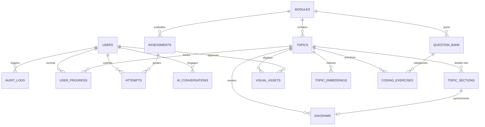

# Database Architecture & Schema Specification

**Project:** Medical Text and Image Processing Learning Platform (AIDS 12605.1)  
**Database Engine:** PostgreSQL 15+ with `pgvector` extension  
**Hosting Provider:** Supabase (Free Tier Hosted Cloud Instance)  
**Status:** Approved for Implementation  

---

## 1. Single Source of Truth & Zero Local Storage

Per project guidelines:
- **Zero Local SQLite/JSON Persistence:** No relational data, course outlines, student submissions, or vector indices may reside on local disk.
- **Hosted Supabase PostgreSQL:** All application data, relational mappings, custom role validations, vector embeddings for AI retrieval, and audit logs reside strictly in the hosted database.
- **Connection Strategy:** Access via pooled connection strings (PgBouncer port `6543`) for stateless serverless environments and direct connection (`5432`) for running database migrations.

---

## 2. Entity-Relationship Diagram (ERD)



---

## 3. PostgreSQL DDL Specification

```sql
-- Enable Extensions
CREATE EXTENSION IF NOT EXISTS "uuid-ossp";
CREATE EXTENSION IF NOT EXISTS "vector";

-- Enum Definitions
CREATE TYPE user_role AS ENUM ('student', 'faculty', 'admin');
CREATE TYPE user_status AS ENUM ('active', 'disabled', 'pending_first_login');
CREATE TYPE question_type AS ENUM ('mcq', 'short_answer', 'coding');
CREATE TYPE difficulty_level AS ENUM ('easy', 'medium', 'hard');
CREATE TYPE asset_status AS ENUM ('draft', 'approved', 'rejected');
CREATE TYPE diagram_type AS ENUM ('mermaid', 'svg', 'interactive_sim');

-- ============================================================================
-- 1. Identity & Audit Tables
-- ============================================================================

CREATE TABLE users (
    id UUID PRIMARY KEY DEFAULT uuid_generate_v4(),
    firebase_uid VARCHAR(128) UNIQUE NOT NULL,
    email VARCHAR(255) UNIQUE NOT NULL,
    full_name VARCHAR(255) NOT NULL,
    role user_role NOT NULL DEFAULT 'student',
    status user_status NOT NULL DEFAULT 'pending_first_login',
    force_password_change BOOLEAN NOT NULL DEFAULT TRUE,
    created_at TIMESTAMPTZ NOT NULL DEFAULT NOW(),
    updated_at TIMESTAMPTZ NOT NULL DEFAULT NOW()
);

CREATE INDEX idx_users_firebase_uid ON users(firebase_uid);
CREATE INDEX idx_users_role ON users(role);
CREATE INDEX idx_users_status ON users(status);

CREATE TABLE audit_logs (
    id UUID PRIMARY KEY DEFAULT uuid_generate_v4(),
    actor_id UUID REFERENCES users(id) ON DELETE SET NULL,
    action VARCHAR(100) NOT NULL,
    target_type VARCHAR(50) NOT NULL,
    target_id VARCHAR(100) NOT NULL,
    metadata JSONB DEFAULT '{}'::jsonb,
    ip_address VARCHAR(45),
    created_at TIMESTAMPTZ NOT NULL DEFAULT NOW()
);

CREATE INDEX idx_audit_logs_actor ON audit_logs(actor_id);
CREATE INDEX idx_audit_logs_created_at ON audit_logs(created_at DESC);

-- ============================================================================
-- 2. Curriculum & Topic Structure (Modules 1 to 6)
-- ============================================================================

CREATE TABLE modules (
    id UUID PRIMARY KEY DEFAULT uuid_generate_v4(),
    module_number INT UNIQUE NOT NULL,
    title VARCHAR(255) NOT NULL,
    description TEXT NOT NULL,
    theory_hours INT NOT NULL DEFAULT 8,
    co_tags TEXT[] NOT NULL DEFAULT '{}',
    order_index INT NOT NULL,
    created_at TIMESTAMPTZ NOT NULL DEFAULT NOW()
);

CREATE TABLE topics (
    id UUID PRIMARY KEY DEFAULT uuid_generate_v4(),
    module_id UUID NOT NULL REFERENCES modules(id) ON DELETE CASCADE,
    slug VARCHAR(100) UNIQUE NOT NULL,
    title VARCHAR(255) NOT NULL,
    order_index INT NOT NULL,
    co_tags TEXT[] NOT NULL DEFAULT '{}',
    read_time_minutes INT NOT NULL DEFAULT 15,
    created_at TIMESTAMPTZ NOT NULL DEFAULT NOW()
);

CREATE INDEX idx_topics_module_id ON topics(module_id);
CREATE INDEX idx_topics_slug ON topics(slug);

CREATE TABLE diagrams (
    id UUID PRIMARY KEY DEFAULT uuid_generate_v4(),
    topic_id UUID NOT NULL REFERENCES topics(id) ON DELETE CASCADE,
    title VARCHAR(255) NOT NULL,
    diagram_type diagram_type NOT NULL,
    code_or_markup TEXT NOT NULL,
    layer_config JSONB DEFAULT '{}'::jsonb,
    interactive_node_map JSONB DEFAULT '{}'::jsonb,
    created_at TIMESTAMPTZ NOT NULL DEFAULT NOW()
);

CREATE TABLE topic_sections (
    id UUID PRIMARY KEY DEFAULT uuid_generate_v4(),
    topic_id UUID NOT NULL REFERENCES topics(id) ON DELETE CASCADE,
    section_number INT NOT NULL,
    section_type VARCHAR(50) NOT NULL, -- e.g., 'overview', 'math_derivation', 'clinical_relevance'
    title VARCHAR(255) NOT NULL,
    content_markdown TEXT NOT NULL,
    formula_latex TEXT,
    linked_diagram_id UUID REFERENCES diagrams(id) ON DELETE SET NULL,
    order_index INT NOT NULL,
    created_at TIMESTAMPTZ NOT NULL DEFAULT NOW(),
    CONSTRAINT uq_topic_section_order UNIQUE (topic_id, order_index)
);

CREATE INDEX idx_topic_sections_topic_id ON topic_sections(topic_id);

-- ============================================================================
-- 3. Visual Assets & Editorial Governance
-- ============================================================================

CREATE TABLE visual_assets (
    id UUID PRIMARY KEY DEFAULT uuid_generate_v4(),
    topic_id UUID NOT NULL REFERENCES topics(id) ON DELETE CASCADE,
    title VARCHAR(255) NOT NULL,
    asset_type VARCHAR(50) NOT NULL, -- 'ai_illustration', 'clinical_scan', 'interactive_svg'
    prompt TEXT,
    model_used VARCHAR(100),
    storage_url TEXT NOT NULL,
    alt_text TEXT NOT NULL,
    license VARCHAR(100) NOT NULL, -- e.g. 'CC BY 4.0', 'Public Domain', 'AI Generated Educational'
    attribution TEXT,
    status asset_status NOT NULL DEFAULT 'draft',
    approved_by UUID REFERENCES users(id) ON DELETE SET NULL,
    approved_at TIMESTAMPTZ,
    created_at TIMESTAMPTZ NOT NULL DEFAULT NOW()
);

CREATE INDEX idx_visual_assets_status ON visual_assets(status);
CREATE INDEX idx_visual_assets_topic ON visual_assets(topic_id);

-- ============================================================================
-- 4. RAG Vector Knowledge Store (Curriculum Grounding)
-- ============================================================================

CREATE TABLE topic_embeddings (
    id UUID PRIMARY KEY DEFAULT uuid_generate_v4(),
    topic_id UUID NOT NULL REFERENCES topics(id) ON DELETE CASCADE,
    section_id UUID REFERENCES topic_sections(id) ON DELETE CASCADE,
    chunk_text TEXT NOT NULL,
    embedding VECTOR(384) NOT NULL, -- sentence-transformers/all-MiniLM-L6-v2 dimension
    metadata JSONB DEFAULT '{}'::jsonb,
    created_at TIMESTAMPTZ NOT NULL DEFAULT NOW()
);

-- Cosine distance index for fast RAG similarity search
CREATE INDEX idx_topic_embeddings_vector ON topic_embeddings 
USING ivfflat (embedding vector_cosine_ops) WITH (lists = 50);

-- ============================================================================
-- 5. Assessments, Question Bank & Pass Rule (>75%)
-- ============================================================================

CREATE TABLE question_bank (
    id UUID PRIMARY KEY DEFAULT uuid_generate_v4(),
    module_id UUID NOT NULL REFERENCES modules(id) ON DELETE CASCADE,
    topic_id UUID REFERENCES topics(id) ON DELETE SET NULL,
    co_tag VARCHAR(10) NOT NULL,
    question_type question_type NOT NULL,
    question_text TEXT NOT NULL,
    options_json JSONB DEFAULT '[]'::jsonb, -- Array of {id, text} for MCQs
    correct_answer_json JSONB NOT NULL,    -- Answer key or regex match
    explanation TEXT NOT NULL,
    rubric_json JSONB DEFAULT '{}'::jsonb,  -- Scoring criteria for short answers
    difficulty difficulty_level NOT NULL DEFAULT 'medium',
    is_approved BOOLEAN NOT NULL DEFAULT TRUE,
    created_at TIMESTAMPTZ NOT NULL DEFAULT NOW()
);

CREATE INDEX idx_question_bank_module ON question_bank(module_id);
CREATE INDEX idx_question_bank_type ON question_bank(question_type);

CREATE TABLE assessments (
    id UUID PRIMARY KEY DEFAULT uuid_generate_v4(),
    module_id UUID NOT NULL REFERENCES modules(id) ON DELETE CASCADE,
    title VARCHAR(255) NOT NULL,
    pass_threshold_pct NUMERIC(5, 2) NOT NULL DEFAULT 75.00,
    time_limit_minutes INT NOT NULL DEFAULT 30,
    num_random_questions INT NOT NULL DEFAULT 15,
    is_active BOOLEAN NOT NULL DEFAULT TRUE,
    created_at TIMESTAMPTZ NOT NULL DEFAULT NOW()
);

CREATE TABLE attempts (
    id UUID PRIMARY KEY DEFAULT uuid_generate_v4(),
    user_id UUID NOT NULL REFERENCES users(id) ON DELETE CASCADE,
    assessment_id UUID NOT NULL REFERENCES assessments(id) ON DELETE CASCADE,
    attempt_number INT NOT NULL,
    score_pct NUMERIC(5, 2) NOT NULL,
    is_passed BOOLEAN GENERATED ALWAYS AS (score_pct > 75.00) STORED,
    answers_json JSONB NOT NULL,
    ai_grading_json JSONB DEFAULT '{}'::jsonb,
    faculty_override_json JSONB DEFAULT '{}'::jsonb,
    started_at TIMESTAMPTZ NOT NULL,
    completed_at TIMESTAMPTZ NOT NULL,
    created_at TIMESTAMPTZ NOT NULL DEFAULT NOW()
);

CREATE INDEX idx_attempts_user_assessment ON attempts(user_id, assessment_id);
CREATE INDEX idx_attempts_score ON attempts(score_pct);

-- View for Student's Best and Latest Assessment Attempts
CREATE OR REPLACE VIEW student_module_summary AS
SELECT 
    a.user_id,
    ass.module_id,
    MAX(a.score_pct) AS best_score_pct,
    BOOL_OR(a.is_passed) AS module_cleared,
    COUNT(a.id) AS total_attempts,
    (
        SELECT score_pct 
        FROM attempts a2 
        WHERE a2.user_id = a.user_id AND a2.assessment_id = a.assessment_id 
        ORDER BY a2.completed_at DESC 
        LIMIT 1
    ) AS latest_score_pct
FROM attempts a
JOIN assessments ass ON a.assessment_id = ass.id
GROUP BY a.user_id, ass.module_id, a.assessment_id;

-- ============================================================================
-- 6. Coding Exercises (Pyodide Execution)
-- ============================================================================

CREATE TABLE coding_exercises (
    id UUID PRIMARY KEY DEFAULT uuid_generate_v4(),
    topic_id UUID NOT NULL REFERENCES topics(id) ON DELETE CASCADE,
    title VARCHAR(255) NOT NULL,
    co_tag VARCHAR(10) NOT NULL,
    problem_statement TEXT NOT NULL,
    starter_code TEXT NOT NULL,
    test_cases_json JSONB NOT NULL, -- Array of {input, expected_output, is_hidden}
    solution_code TEXT NOT NULL,
    created_at TIMESTAMPTZ NOT NULL DEFAULT NOW()
);

-- ============================================================================
-- 7. Student Progress & AI Conversations
-- ============================================================================

CREATE TABLE user_progress (
    id UUID PRIMARY KEY DEFAULT uuid_generate_v4(),
    user_id UUID NOT NULL REFERENCES users(id) ON DELETE CASCADE,
    topic_id UUID NOT NULL REFERENCES topics(id) ON DELETE CASCADE,
    is_completed BOOLEAN NOT NULL DEFAULT FALSE,
    time_spent_seconds INT NOT NULL DEFAULT 0,
    last_accessed_at TIMESTAMPTZ NOT NULL DEFAULT NOW(),
    CONSTRAINT uq_user_topic UNIQUE (user_id, topic_id)
);

CREATE TABLE ai_conversations (
    id UUID PRIMARY KEY DEFAULT uuid_generate_v4(),
    user_id UUID NOT NULL REFERENCES users(id) ON DELETE CASCADE,
    topic_id UUID NOT NULL REFERENCES topics(id) ON DELETE CASCADE,
    prompt TEXT NOT NULL,
    response TEXT NOT NULL,
    citations_json JSONB NOT NULL DEFAULT '[]'::jsonb,
    referenced_diagram_node VARCHAR(100),
    created_at TIMESTAMPTZ NOT NULL DEFAULT NOW()
);

CREATE INDEX idx_ai_conversations_user ON ai_conversations(user_id);
```

---

## 4. Row-Level Security (RLS) Policies

All tables in the hosted database enforce RLS:
1. `users`: Admins can read/write all records. Faculty can view student profiles. Students can read only their own profile.
2. `visual_assets`: Students can SELECT only records where `status = 'approved'`. Faculty and Admins can SELECT/INSERT/UPDATE all.
3. `question_bank`: Students have zero direct access to `question_bank` or `correct_answer_json`. Quizzes are served via sanitized backend RPC/API endpoints.
4. `attempts`: Students can SELECT only their own attempts. Faculty and Admins can view all class attempts.
