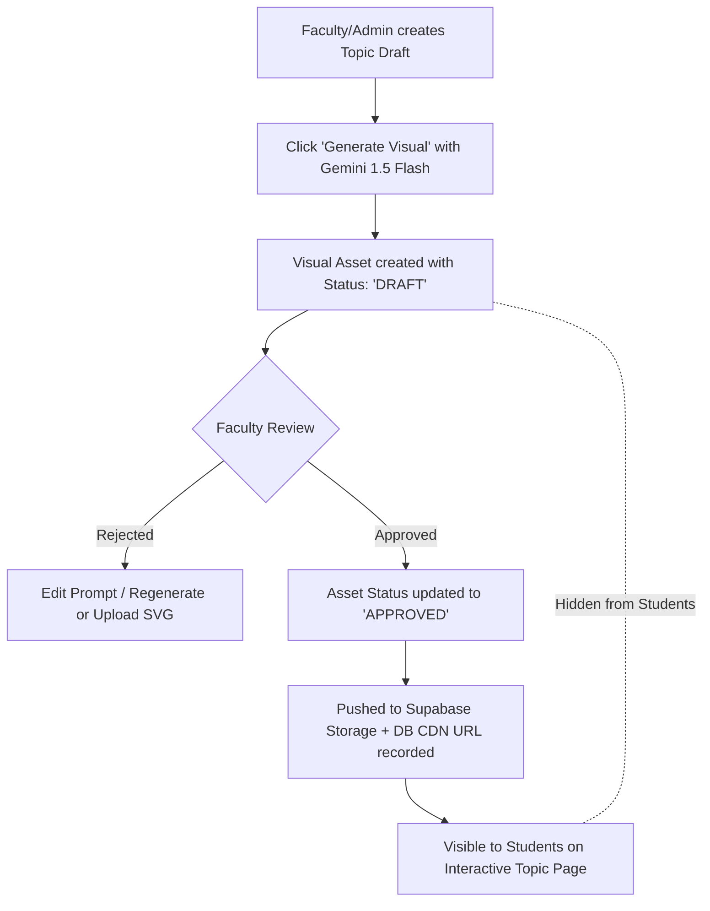

# Design & UX Specification

**Project:** Medical Text and Image Processing Learning Platform (AIDS 12605.1)  
**Institution:** Faculty of Engineering and Technology (FET), DMIHER  
**Status:** Approved for Implementation  

---

## 1. Design System & Brand Identity

The platform balances high-tech academic rigor with clinical precision. It uses the official DMIHER institutional palette paired with an ultra-clean, clinical-grade UI (Inter typography, subtle glassmorphic headers, crisp SVG iconography, high-contrast dark/light clinical themes).

### 1.1 Color Tokens

```css
:root {
  /* DMIHER FET Primary Palette */
  --color-primary-navy: #0B2545;       /* Deep Academic Navy (DMIHER FET Primary) */
  --color-primary-navy-dark: #07192F;  /* Background for dark clinical mode */
  --color-accent-gold: #D4AF37;        /* Institutional Gold (Accents, badges, highlights) */
  --color-accent-gold-hover: #B8972C;  /* Darker Gold for interactive states */

  /* Clinical Semantics */
  --color-clinical-cyan: #0284C7;      /* Medical imaging / diagnostic accent */
  --color-clinical-teal: #0D9488;      /* Process pipelines & flowcharts */
  --color-success: #16A34A;            /* Pass threshold (>75%), active node */
  --color-warning: #EAB308;            /* Draft status, quota alert */
  --color-danger: #DC2626;             /* Below pass threshold, error */

  /* Neutrals */
  --color-surface-light: #F8FAFC;      /* App light background */
  --color-surface-white: #FFFFFF;      /* Card and panel background */
  --color-border-subtle: #E2E8F0;      /* Card dividers and panel borders */
  --color-text-main: #0F172A;          /* Slate 900 for high-contrast reading */
  --color-text-muted: #64748B;         /* Slate 500 for secondary descriptions */

  /* Dark Clinical Theme */
  --color-dark-bg: #090D16;            /* Diagnostic workstation black */
  --color-dark-surface: #131B2E;       /* Workstation panel surface */
  --color-dark-border: #1E293B;        /* High-contrast workstation borders */
  --color-dark-text: #F1F5F9;          /* High-legibility text */
}
```

### 1.2 Typography & Iconography
- **Body & Headings:** `Inter`, `-apple-system`, `BlinkMacSystemFont`, `Segoe UI`, `Roboto`, `sans-serif`.
- **Formulas & Mathematics:** `KaTeX` / `MathJax` typography for clear rendering of spatial transformation matrices, 2D Discrete Fourier Transforms (DFT), and Radon transform equations.
- **Code & Syntax:** `JetBrains Mono` / `Fira Code` for in-browser Python (Pyodide) scripts and DICOM metadata tags.
- **Icons:** `Lucide React` for lightweight, accessible SVG icons.

---

## 2. Information Architecture & Navigation

```
[Platform Root]
  ├── /login (Invite-Only Login & First-Time Password Reset)
  ├── /dashboard (Role-specific entry: Student / Faculty / Admin)
  ├── /course
  │     ├── /overview (Syllabus, 6 Modules, CO Mapping, Grading Scheme)
  │     ├── /module-[1-6] (Module overview, Topic index, Assessment status)
  │     └── /module-[id]/[topic-slug] (Interactive Dual-Panel Topic Page)
  ├── /playground (Client-Side Medical Image Processing & DICOM Viewer)
  ├── /assessments
  │     ├── /module-[id]/quiz (Randomized questions, Best vs. Latest attempt)
  │     └── /module-[id]/coding (Pyodide sandbox tests)
  ├── /faculty (Content Authoring, Draft Visual Approvals, Analytics, Grading)
  └── /admin (Invite Management, CSV Bulk Import, User Roles, Audit Logs)
```

---

## 3. The Interactive Topic-Page Template (Core Feature)

Every topic in the syllabus adheres to a unified, synchronized dual-panel layout engineered for deep conceptual and visual learning.

### 3.1 Desktop Layout (Dual-Panel Synchronized View)
- **Grid Layout:** `grid-cols-12` with `col-span-7` for the explanatory content panel and `col-span-5` for the sticky visual panel.
- **Left Panel (Scrollable Explanatory Column):**
  1. **Breadcrumb & Header:** Module tag, Topic title, estimated read time, Course Outcome (e.g., `CO1, CO2`), and completion checkbox.
  2. **1. Learning Objectives:** Specific outcomes keyed to Bloom's taxonomy.
  3. **2. Overview & Clinical Context:** Real-world medical relevance (e.g., why CT windowing matters for subdural hematoma vs. ischemic stroke).
  4. **3. Detailed Technical Explanation:** Equations, step-by-step mathematical derivation, worked clinical examples.
  5. **4. Common Misconceptions & Pitfalls:** "Things students get wrong" (e.g., confusing Hounsfield Units with raw attenuation coefficients $\mu$).
  6. **5. Step-by-Step Workflow:** Numbered procedural stages linked to the visual panel.
  7. **6. Interactive Demo:** In-page slider/controls (e.g., Window Width/Level slider or 3x3 Sobel kernel interactive filter).
  8. **7. Summary & Key Takeaways:** Bulleted recap.
  9. **8. Quick Check (Formative MCQ):** 3–5 instant-feedback MCQs with explanation on click.
  10. **9. Short-Answer Practice:** Concept check prompt with AI-assisted self-evaluation.
  11. **10. Pyodide Coding Exercise (where applicable):** Interactive code block with runnable NumPy/OpenCV/pydicom starter code.
  12. **11. Academic References & Citations:** Birkfellner, Dougherty, open dataset licenses.
  13. **12. Previous / Next Topic Navigation Bar:** Linear progression controls.

- **Right Panel (Sticky Visual & Diagram Workstation):**
  - Uses `position: sticky; top: 5rem; max-height: calc(100vh - 6rem)`.
  - **Dynamic Synchronization:** Uses an `IntersectionObserver` on the left panel sections. As the student scrolls through Section 3 (Attenuation physics), the right visual transitions smoothly to the *X-ray Attenuation & Photon Interaction Diagram*.
  - When scrolling to Section 5 (Pipeline), the right visual morphs into the *Interactive Pipeline Flowchart*.
  - Contains tabbed controls: `Diagram (Mermaid/SVG)` | `Interactive Simulation` | `Clinical Scan Reference`.
  - Fullscreen expansion toggle for deep inspection during lecture or study.

### 3.2 Mobile Layout (Responsive Stacking)
- On screens `< 1024px`, the layout smoothly converts to a single-column flow (`grid-cols-1`).
- The visual workstation un-sticks and positions directly beneath its corresponding section heading before the text, preserving context without horizontal cramming.
- Touch-friendly pan and pinch-zoom enabled on all Mermaid/SVG diagrams.

---

## 4. Interactive Diagram System

### 4.1 Technology Choice: Mermaid + Custom SVG
- **Mermaid.js:** Rendered client-side for dynamic state, step-by-step process highlights, and data flow pipelines (e.g., *DICOM File Tag Hierarchy*, *Convolution Operation Pipeline*, *Region Growing Segmentation*).
- **Custom Interactive SVG:** Employed for anatomical diagrams, Fourier frequency spectrum maps, and Radon transform projection geometries.

### 4.2 Interactivity Features
1. **Node Click-to-Explain:** Clicking any block in a pipeline highlights the exact paragraph and formula in the left panel.
2. **Interactive Hover Tooltips:** Hovering over nodes (e.g., "ADC Converter", "Pre-Amplifier", "High-Pass Filter") displays clinical definition and SNR trade-offs.
3. **Step-Through Mode:** "Step Forward" and "Step Backward" buttons animate the traversal of data packets or photons through the pipeline.
4. **Layer Toggle:** Allows students to toggle "Hardware Layer", "Algorithmic Layer", and "Clinical Quality Layer" on complex multi-tier diagrams.
5. **Zoom & Pan:** Smooth mouse-wheel zoom and drag-to-pan with an instant "Reset View" button.

---

## 5. Visual Asset Generation & Approval Lifecycle

AI-generated medical diagrams can contain anatomical or technical hallucinations. Therefore, strict editorial governance is enforced:



- Real diagnostic scans must originate from open-access repositories (e.g., NIH Clinical Center, Cancer Imaging Archive, MedNIST) with CC-BY or public domain licenses, citing dataset name, contributor, and license in the visual caption.

---

## 6. Accessibility & Responsiveness (WCAG 2.1 AA)
- High-contrast color ratios: All text against background meets or exceeds `4.5:1` contrast ratio.
- Keyboard navigation: All diagram nodes, modal dialogs, and playground sliders support `Tab`, `Shift+Tab`, `Enter`, and Arrow keys.
- Screen readers: All SVG and Mermaid diagrams provide programmatic `<title>`, `<desc>`, and descriptive `aria-label` attributes.
- Reduced motion: Respects `@media (prefers-reduced-motion: reduce)` by disabling step-through animations and transitions.
