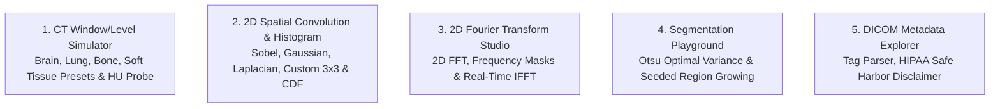

# Platform Features Specification

**Project:** Medical Text and Image Processing Learning Platform (AIDS 12605.1)  
**Institution:** Faculty of Engineering and Technology, Adani Institute of Higher Education and Research (Deemed to be University)  
**Status:** Approved for Implementation  

---

## 1. Interactive Dual-Panel Topic Template

The topic page is the core pedagogical engine of the platform, engineered to eliminate cognitive friction between abstract mathematical principles and visual clinical reality.

### 1.1 Structural Architecture
- **Desktop (Dual-Panel Synchronized Mode):**
  - Left Panel (`7/12` width): Textual narrative, mathematical formulations (KaTeX), clinical rationale, worked examples, common pitfalls, summary, and quick checks across 144 slide units.
  - Right Panel (`5/12` width): Sticky visual workstation containing interactive Mermaid/SVG diagrams, dynamic sliders, or clinical scan workstations.
- **Mobile (Responsive Stacking Mode):**
  - Below `1024px`, the visual workstation flows inline, rendering directly beneath the conceptual section it represents.
- **Active Section Observer:**
  - An `IntersectionObserver` monitors which left-panel section is active in the viewport and dispatches an event to the right panel. The right workstation dynamically updates its diagram state or highlights relevant visual layers with smooth CSS transitions.

---

## 2. Client-Side Interactive Medical Image Playgrounds

All playgrounds execute **100% client-side** using HTML5 Canvas, WebAssembly, and JavaScript with sub-16ms latency (60 FPS) and zero backend server load.

### 2.1 CT Window Width / Window Level (WW/WL) Simulator (`/playground/windowing`)
- **Educational Objective:** Understand Hounsfield Units (HU) dynamic range ($-1000$ to $+3000$ HU) and how window width (WW) and window level (WL) map 12-bit CT data to 8-bit display monitors ($0–255$).
- **Features:**
  - Standard clinical presets: **Brain** ($WL=40, WW=80$), **Bone** ($WL=400, WW=1800$), **Lung** ($WL=-600, WW=1500$), **Soft Tissue** ($WL=50, WW=350$).
  - Live cursor probe reading exact Hounsfield Units (HU) at mouse position.
  - Real-time intensity transfer function curve rendered on canvas.

### 2.2 2D Spatial Convolution & Histogram Equalizer (`/playground/convolution`)
- **Educational Objective:** Observe linear filtering, gradient operators, and contrast equalization on diagnostic scans.
- **Features:**
  - Interactive $3 \times 3$ kernel grid (Sobel Horizontal/Vertical, Gaussian Blur, Laplacian second derivative, Sharpen, Edge Detect) with custom user-editable weights.
  - Step-by-step pixel convolution math inspector.
  - Real-time CDF-based histogram equalization toggle with before/after contrast comparisons.

### 2.3 2D Fast Fourier Transform (FFT) Studio (`/playground/fourier`)
- **Educational Objective:** Connect spatial frequency components to image sharpness, noise, and periodic artifacts.
- **Features:**
  - Fast client-side 2D FFT mapping spatial scans to 2D centered k-space log magnitude power spectrum.
  - Interactive frequency masks: Ideal Low-Pass, High-Pass, Butterworth, and Notch rejection masks.
  - Real-time Inverse FFT (IFFT) spatial reconstruction demonstrating noise and stripe suppression.

### 2.4 Medical Image Segmentation (`/playground/segmentation`)
- **Educational Objective:** Learn image binarization and morphological region grouping for lesion isolation.
- **Features:**
  - Real-time Otsu global thresholding calculating between-class variance maximization $\sigma_B^2(t)$.
  - Interactive Seeded Region Growing: Student clicks a seed point on an anatomical scan; the algorithm expands outward based on intensity difference $\Delta I$.
  - Morphological operations: Dilation, Erosion, Opening, and Closing.

### 2.5 Privacy-First DICOM Metadata Explorer (`/playground/dicom`)
- **Educational Objective:** Understand medical image storage standards, transfer syntaxes, and mandatory DICOM tags.
- **Features:**
  - Pre-loaded public sample DICOM files (Normal Head CT, Chest X-ray, Knee MRI).
  - Searchable tree view of DICOM tags: `(0010,0010)` Patient Name, `(0028,0010)` Rows, `(0028,0030)` Pixel Spacing, `(0020,0032)` Image Position Patient.
  - Prominent HIPAA Safe Harbor de-identification disclaimer and upload protection blocking identifiable patient files.

---

## 3. Clinical Diagnostic Missions, Pipeline Builder & Mini-Games

### 3.1 Clinical Diagnostic Missions (`/playground/missions`)
Goal-based clinical challenges with physiological targets and server-side verification:
1. **Mission 1: Calvarial Bone Fracture Delineation** ($WL=400, WW=1500$).
2. **Mission 2: Acute Subdural Hematoma Contrast** ($WL=65, WW=130$).
3. **Mission 3: Pulmonary Parenchyma & Bullae Isolation** ($WL=-600, WW=1500$).
4. **Mission 4: Brain Glioblastoma Otsu Variance Segmentation**.
5. **Mission 5: Periodic RF Moiré Stripe Suppression in 2D Fourier Spectrum**.

Features:
- Live target contrast scoring ($0–100$), 1-to-3 Star rating system, staged physiological hints (-5 pts penalty).
- Dual client practice scoring + server-side verification (`/api/v1/missions/submit`) to prevent score tampering.
- Anonymized class leaderboard using privacy-preserving aliases (e.g. `Curie-42`, `Roentgen-07`).

### 3.2 Bioimage Pipeline Builder (`/playground/pipeline`)
- Sequential visual block chaining: Gaussian Blur $\rightarrow$ Otsu Thresholding $\rightarrow$ Morphological Erode/Dilate $\rightarrow$ Measure Area & Centroid.
- Live intermediate canvas thumbnail previews at each pipeline stage, mirroring Fiji / Bioimage workflows.
- One-click **"Export Equivalent Python Script"** generating production-ready Python code with `cv2`, `numpy`, and `scipy.ndimage`.

### 3.3 "See the Math" Micro-Inspectors
- **Neighborhood Pixel Inspector:** Hover any pixel to view its $3 \times 3$ neighborhood, kernel matrix weights, element-wise products, and discrete convolution sum ($K \ast I$).
- **Curtain Compare Slider:** Interactive split divider allowing students to slide between raw scan and processed output.
- **Live 256-Bin Intensity Histogram:** Real-time distribution visualization with mean ($\mu$), standard deviation ($\sigma$), and threshold markers.

### 3.4 Clinical Mini-Games Hub (`/playground/games`)
- **Filter Match:** Clinical case diagnosis matching optimal filters (Median vs. Gaussian vs. Unsharp Mask) for detector impulse noise, Poisson quantum mottle, and speckle.
- **Spot the Artifact:** Identify Beam Hardening, Motion Ghosting, Phase Aliasing, and Detector Ring Artifacts with physics explanations.
- **MRI Spin-Echo Contrast Simulator:** Interactive TR ($300–4000$ ms) and TE ($10–150$ ms) sliders calculating $S = \rho(1 - e^{-TR/T_1})e^{-TE/T_2}$ to visually morph between T1-weighted, T2-weighted, and Proton Density contrast.

---

## 4. In-Browser Pyodide WebAssembly Coding Sandbox

- Zero-cost client-side Python execution environment powered by **Pyodide (WebAssembly)**.
- Pre-loaded with scientific computing packages (`numpy`, `opencv-python`, `pydicom`).
- Embedded coding exercises with automated test assertions, execution output consoles, and automated grading without external cloud compute expense.

---

## 5. Lexi Academic AI Guide v2.0 (Claude-Style Architecture)

Lexi is the institutional, project-centric AI Academic Guide for Medical Text and Image Processing:
- **Claude-Style Chat UI:** Right-aligned speech bubble for user messages, open editorial layout for Lexi responses, floating card composer, and real-time thinking indicator pill.
- **3 Seamless Display Modes:**
  - **Normal:** Bottom-right floating window ($380\text{px} \times 600\text{px}$, max 80vh) with history drawer.
  - **Half:** Right docked panel (50% desktop, 40% tablet); host page dynamically shrinks beside it (`flex-1`) with zero overlays.
  - **Full:** Full-viewport experience with collapsible sidebar and centered conversation column.
  - Shortcuts: `Ctrl/Cmd+J` (toggle), `Ctrl/Cmd+Shift+1/2/3` (modes), `Esc` (exit), `Ctrl/Cmd+K` (focus composer).
- **Fast Scope Gate & Prompt Injection Interception:** 3-class classifier (`project`, `off_topic`, `greeting`), blocking injections with an institutional refusal notice.
- **Grounded Vector RAG:** 7 documentation modules in `/knowledge/` chunked and embedded via `gemini-embedding-001` with vector cosine similarity. Responses cite exact sources (`{ file, section }`).
- **Multi-Key Pool:** Server-side key rotation with exponential backoff on `429`/`503` rate limits.
- **Automated Eval Suite:** `eval/project-eval.ts` achieving **100% (40/40)** accuracy across 5 categories.

---

## 6. Assessment & Grading System (>75% Pass Rule)

1. **Randomized Question Bank:** Quizzes pull random question selections balanced by difficulty and Course Outcome (CO1–CO4).
2. **Mastery Threshold:** Score must strictly exceed **75.0%** to mark the module as "Cleared".
3. **Attempt Tracking:** Both the student's **Best Score** (for prerequisite clearance) and **Latest Attempt** (timestamp, duration, answers) are recorded.
4. **Remediation Loop:** Students scoring $\le 75\%$ receive targeted diagnostic pointers to specific topic sections and diagrams.

---

## 7. Faculty Authoring & Content Studio

1. **Side-by-Side Live Preview:** Authoring studio displays Markdown editor on the left and live student view on the right.
2. **Visual Approval Workflow:** All visuals and illustrations remain in `draft` state until explicitly approved by a faculty member.
3. **Grading Overrides:** Faculty can review AI-graded short-answer submissions, adjust point awards, and provide personalized feedback.
4. **Analytics Dashboard:** Aggregate class distribution curve, pass rate per module, question difficulty index, and at-risk student alerts.
