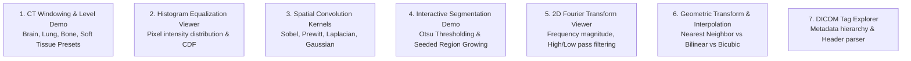

# Platform Features Specification

**Project:** Medical Text and Image Processing Learning Platform (AIDS 12605.1)  
**Status:** Approved for Implementation  

---

## 1. Interactive Dual-Panel Topic Template

The topic page is the core pedagogical engine of the platform, engineered to eliminate cognitive friction between abstract mathematical principles and visual clinical reality.

### 1.1 Structural Architecture
- **Desktop (Dual-Panel Synchronized Mode):**
  - Left Panel (`7/12` width): Textual narrative, mathematical formulations (KaTeX), clinical rationale, worked examples, common pitfalls, summary, and quick checks.
  - Right Panel (`5/12` width): Sticky visual workstation containing interactive Mermaid/SVG diagrams, dynamic sliders, or clinical scan comparisons.
- **Mobile (Responsive Stacking Mode):**
  - Below `1024px`, the visual workstation flows inline, rendering immediately following the conceptual section it represents.
- **Active Section Observer:**
  - An `IntersectionObserver` monitors which left-panel section is active in the viewport and dispatches an event to the right panel. The right workstation dynamically updates its diagram state or highlights relevant visual layers with smooth CSS transitions.

---

## 2. Interactive In-Browser Medical Image Demos

All demos run **100% client-side** using HTML5 Canvas, WebAssembly, and JavaScript. **No student images or processed frames are stored locally or uploaded to servers.**

### 2.1 Demo 1: CT Window/Level Dynamic Range Slider
- **Educational Objective:** Understand Hounsfield Units (HU) dynamic range ($-1000$ to $+3000$ HU) and how window width (WW) and window level (WL) map 12-bit CT data to 8-bit display monitors ($0–255$).
- **Features:**
  - Presets: **Brain** (WL: 40, WW: 80), **Bone** (WL: 400, WW: 1800), **Lung** (WL: -600, WW: 1500), **Soft Tissue** (WL: 50, WW: 350).
  - Custom dual sliders for real-time windowing adjustment.
  - Live intensity transfer function curve rendered on canvas.

### 2.2 Demo 2: Histogram Equalization & Pixel Statistics
- **Educational Objective:** Analyze contrast enhancement and cumulative distribution functions (CDF).
- **Features:**
  - Interactive histogram plotting pixel count against grayscale intensity (0–255).
  - One-click toggle between original histogram and equalized histogram.
  - Side-by-side comparison of original medical scan vs. equalized scan.

### 2.3 Demo 3: Spatial Filtering & Convolution Kernels
- **Educational Objective:** Observe the spatial impact of linear and non-linear filter kernels on medical images.
- **Features:**
  - Filter options: Gaussian Blur ($3 \times 3$, $5 \times 5$), Sobel Horizontal & Vertical ($G_x, G_y$), Laplacian (second derivative), Unsharp Masking.
  - Interactive $3 \times 3$ kernel grid where students can manually edit kernel weights and watch live pixel convolution.

### 2.4 Demo 4: Thresholding & Region Growing Segmentation
- **Educational Objective:** Learn image binarization and morphological region grouping.
- **Features:**
  - Global threshold slider with real-time Otsu threshold calculation displayed.
  - Interactive Seeded Region Growing: Student clicks a point on an anatomical scan (e.g., ventricular space); the algorithm expands outward until intensity gradients exceed a user-defined threshold $\Delta I$.

### 2.5 Demo 5: 2D Discrete Fourier Transform (FFT) Viewer
- **Educational Objective:** Connect spatial frequency components to image sharpness and noise.
- **Features:**
  - Displays original spatial domain scan alongside its 2D Fourier Magnitude Spectrum (log-scaled and centered).
  - Interactive circular mask slider allowing students to apply Ideal Low-Pass, High-Pass, or Butterworth filters in frequency space and compute the Inverse FFT (IFFT) in real time.

### 2.6 Demo 6: Spatial Transformations & Interpolation Comparison
- **Educational Objective:** Grasp pixel discretization artifacts during rotation, affine shearing, and zoom.
- **Features:**
  - Controls: Rotation angle ($-180^\circ$ to $+180^\circ$), Scale ($0.5\times$ to $3.0\times$), Translation ($\Delta x, \Delta y$).
  - Interpolation toggle: Nearest Neighbor vs. Bilinear vs. Bicubic interpolation, highlighting grid aliasing and edge blurring differences.

### 2.7 Demo 7: DICOM Header & Metadata Explorer
- **Educational Objective:** Understand medical image storage standards and mandatory DICOM tags.
- **Features:**
  - Pre-loaded public sample DICOM files (Normal Head CT, Chest X-ray, Knee MRI).
  - Searchable tree view of DICOM tags: Group/Element identifiers (e.g., `(0010,0010)` Patient Name, `(0028,0010)` Rows, `(0028,0030)` Pixel Spacing, `(0020,0032)` Image Position Patient).
  - Privacy Notice: Prominent banner explaining DICOM de-identification (HIPAA Safe Harbor standard). Real patient upload is explicitly blocked.

---

## 3. Assessment & Grading System (>75% Pass Rule)

1. **Randomized Question Bank:** Quizzes pull random question selections balanced by difficulty (Easy 30%, Medium 50%, Hard 20%) and Course Outcome.
2. **Mastery Threshold:** Score must strictly exceed **75.0%** to mark the module as "Cleared".
3. **Attempt Tracking:** Both the student's **Best Score** (used for module prerequisites and class standing) and **Latest Attempt** (timestamp, duration, answers) are recorded.
4. **Remediation Loop:** Students scoring $\le 75\%$ receive targeted diagnostic pointers to specific topic sections and diagrams.

---

## 4. Faculty Authoring & Content Studio

1. **AI-Assisted Topic Drafting:** Faculty can select a module, enter syllabus keywords, and generate a draft topic containing structured sections, suggested Mermaid diagrams, and formative quiz questions.
2. **Side-by-Side Live Preview:** Authoring studio displays Markdown editor on the left and live student view on the right.
3. **Visual Approval Workflow:** All visuals and AI illustrations remain in `draft` state until explicitly approved by a faculty member.
4. **Grading Overrides:** Faculty can review AI-graded short-answer submissions, adjust point awards, and provide personalized feedback.

---

## 5. Analytics, Progress & Class Dashboard

- **Student Dashboard:** Visual progress ring, Course Outcome mastery percentage (CO1–CO4), module pass status badges, and quiz attempt history.
- **Faculty Dashboard:** Aggregate class distribution curve, pass rate per module, question difficulty index (identifying questions with $<40\%$ correct responses), and at-risk student alerts.
- **Course Announcements:** Faculty-published updates regarding lab sessions, exam schedules, and curriculum notices.
