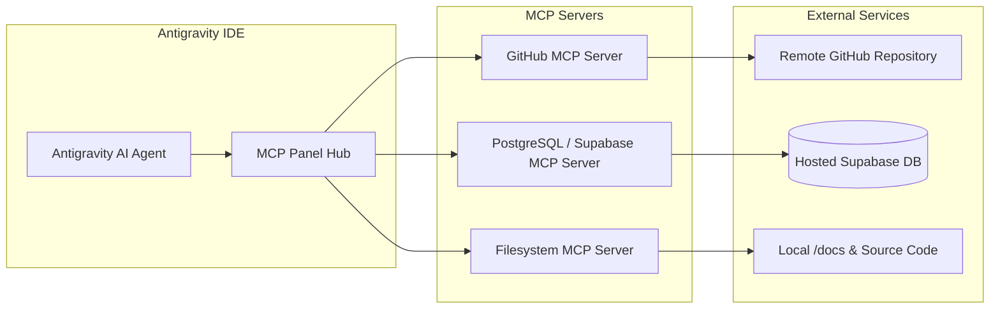

# Model Context Protocol (MCP) Integration Specification

**Project:** Medical Text and Image Processing Learning Platform (AIDS 12605.1)  
**Status:** Approved for Implementation  

---

## 1. Overview & Security Mandate

Model Context Protocol (MCP) provides standardized, sandboxed connectivity between IDE AI agents and external services (Hosted Database, GitHub Version Control, and Local Project Files).

> [!CAUTION]
> **Strict Security Rule:** Never commit `mcp_config.json` or any file containing active database connection strings, GitHub Personal Access Tokens (PAT), or service keys to the Git repository. Always reference environment variables or inject credentials via secure local IDE secret vaults.

---

## 2. Integrated MCP Servers



### 2.1 Hosted PostgreSQL / Supabase MCP Server
- **Server Package:** `@modelcontextprotocol/server-postgres`
- **Purpose:**
  - Execute DDL migrations against the remote Supabase database instance.
  - Verify schema state, tables, column types, and foreign keys.
  - Execute idempotent seed scripts for the 6 course modules and question banks.
  - Query student assessment attempt summaries to verify test outcomes without local database emulators.
- **Connection String:** Provided via environment variable `SUPABASE_DATABASE_URL` (SSL mode enabled: `?sslmode=require`).
- **Configuration Snippet:**
```json
{
  "mcpServers": {
    "supabase-postgres": {
      "command": "npx",
      "args": ["-y", "@modelcontextprotocol/server-postgres", "${SUPABASE_DATABASE_URL}"]
    }
  }
}
```

### 2.2 GitHub MCP Server
- **Server Package:** `@modelcontextprotocol/server-github`
- **Purpose:**
  - Create feature branches for each milestone (e.g., `feat/auth-system`, `feat/interactive-topic-pages`).
  - Open pull requests, inspect commit history, and push conventional commits.
  - Automate issue tracking and release notes for course delivery milestones.
- **Configuration Snippet:**
```json
{
  "mcpServers": {
    "github": {
      "command": "npx",
      "args": ["-y", "@modelcontextprotocol/server-github"],
      "env": {
        "GITHUB_PERSONAL_ACCESS_TOKEN": "${GITHUB_PAT}"
      }
    }
  }
}
```

### 2.3 Filesystem MCP Server
- **Server Package:** `@modelcontextprotocol/server-filesystem`
- **Purpose:**
  - Sandboxed access to project documentation (`/docs`), frontend assets, and backend code.
  - Prevents accidental read/write access outside the workspace boundary.
- **Configuration Snippet:**
```json
{
  "mcpServers": {
    "workspace-filesystem": {
      "command": "npx",
      "args": ["-y", "@modelcontextprotocol/server-filesystem", "c:/Users/jthak/OneDrive/Attachments/Desktop/E-Learning"]
    }
  }
}
```

---

## 3. Safe Operational Workflows with MCP

1. **Schema Verification Loop:**
   When running migrations, the agent uses `supabase-postgres` to query `information_schema.tables` and confirm that all 15 tables and views have been created with exact RLS constraints.
2. **Feature Branch Isolation:**
   Before implementing any component, the agent interacts with `github` MCP to ensure work begins on a clean branch branched from `main`.
3. **Audit Before Merge:**
   The agent utilizes GitHub MCP to formulate clean PR summaries highlighting Course Outcome (CO) coverage, test results, and browser verification screenshots.
